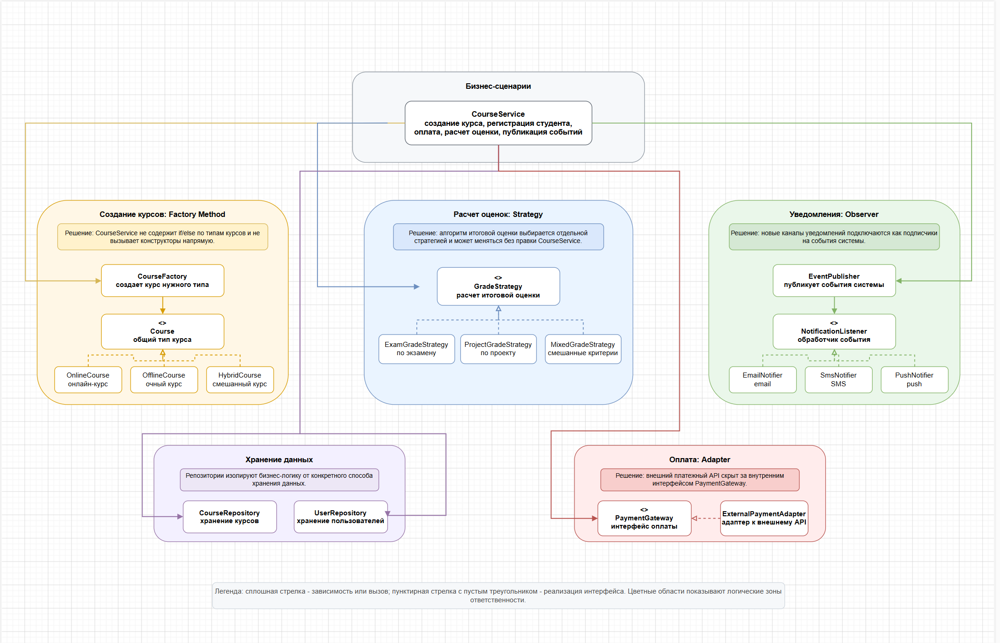
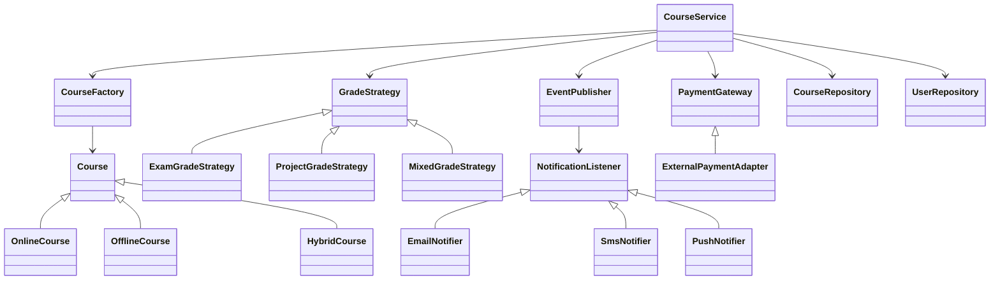
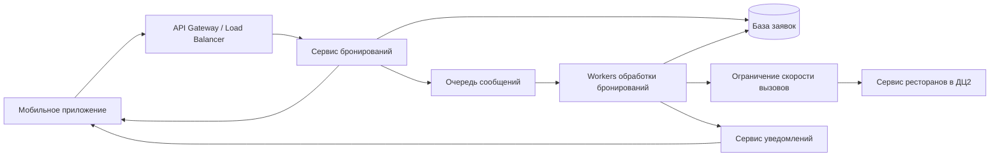
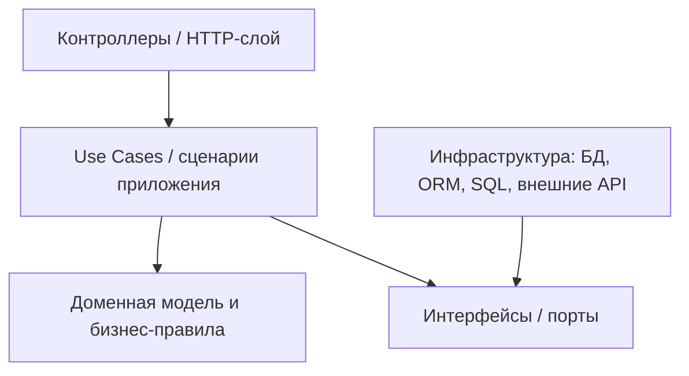
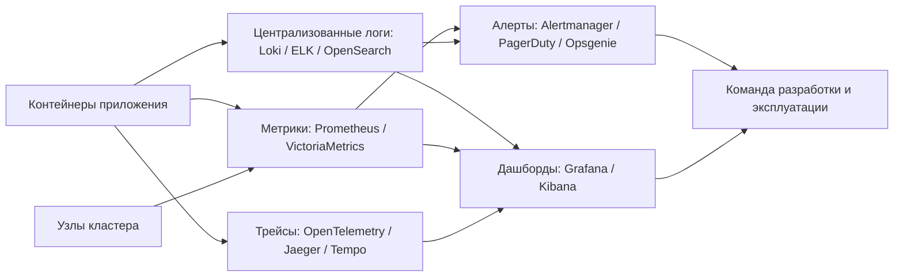

# Задание 1. Анализ и проектирование архитектуры системы онлайн-курсов

## Условие

Рассматривается система управления онлайн-курсами. Система поддерживает:

- создание курсов;
- регистрацию студентов;
- прохождение обучения;
- расчет итоговой оценки;
- отправку уведомлений;
- оплату курсов через внешний сервис.

Текущая реализация построена вокруг класса `CourseManager`.

`CourseManager` выполняет сразу несколько функций:

- создает объекты курсов разных типов, например `OnlineCourse` и `OfflineCourse`;
- хранит данные о курсах и пользователях;
- рассчитывает итоговую оценку студентов;
- отправляет уведомления, например через `sendEmail(...)`;
- выполняет оплату через прямой вызов внешнего API.

## Краткий анализ исходной системы

В текущей архитектуре класс `CourseManager` является перегруженным классом, в котором сосредоточено слишком много обязанностей. Он одновременно отвечает за создание объектов, бизнес-логику, хранение данных, уведомления и интеграцию с внешним платежным сервисом.

Это приводит к нескольким архитектурным проблемам:

- нарушается принцип единственной ответственности, так как один класс отвечает за разные части системы;
- нарушается принцип открытости/закрытости, так как добавление нового типа курса требует изменения существующего кода;
- создание курсов жестко связано с конкретными классами `OnlineCourse` и `OfflineCourse`;
- алгоритм расчета оценки зафиксирован внутри одного метода и не может быть заменен без изменения `CourseManager`;
- отправка уведомлений встроена прямо в бизнес-логику;
- платежный сервис вызывается напрямую, из-за чего система зависит от конкретного внешнего API;
- похожая логика может дублироваться в разных методах.

Таким образом, система становится трудной для расширения, тестирования и сопровождения.

## Предлагаемая структура системы

В новой архитектуре обязанности распределяются между отдельными классами и интерфейсами. Основной сервис больше не должен самостоятельно создавать курсы, считать оценки, отправлять уведомления и работать с конкретным платежным API.

Основные элементы новой структуры:

- `CourseService` - основной сервис бизнес-сценариев;
- `Course` - общий интерфейс или абстрактный класс курса;
- `OnlineCourse`, `OfflineCourse`, `HybridCourse` - конкретные типы курсов;
- `CourseFactory` - фабрика для создания курсов;
- `GradeStrategy` - интерфейс алгоритма расчета оценки;
- `ExamGradeStrategy`, `ProjectGradeStrategy`, `MixedGradeStrategy` - конкретные стратегии расчета;
- `EventPublisher` - компонент для публикации событий;
- `NotificationListener` - общий интерфейс обработчика уведомлений;
- `EmailNotifier`, `SmsNotifier`, `PushNotifier` - конкретные каналы уведомлений;
- `PaymentGateway` - внутренний интерфейс оплаты;
- `ExternalPaymentAdapter` - адаптер к внешнему платежному API;
- `CourseRepository`, `UserRepository` - классы для работы с хранением данных.

## Диаграммы архитектуры

В работе используются две версии диаграммы:

- в свободной форме [`course-architecture.drawio`](course-architecture.drawio);
- UML-диаграмма классов (mermaid)

### В свободной форме 



В `.drawio`-диаграмме выделены следующие зоны:

- бизнес-сценарии;
- создание курсов через `Factory Method`;
- расчет оценок через `Strategy`;
- уведомления через `Observer`;
- хранение данных;
- оплата через `Adapter`.

### UML mermaid-диаграмма




## Описание основных классов

### `CourseService`

Отвечает за основные бизнес-сценарии системы:

- создание курса;
- регистрацию студента на курс;
- запуск оплаты;
- завершение обучения;
- расчет итоговой оценки;
- публикацию событий о важных действиях.

`CourseService` не должен напрямую создавать конкретные курсы, отправлять письма или вызывать внешний платежный API.

### `Course`

Общий интерфейс или абстрактный класс для всех типов курсов.

Примеры реализаций:

- `OnlineCourse`;
- `OfflineCourse`;
- `HybridCourse`.

Благодаря этому код может работать с курсом через общий тип `Course`, не завися от конкретной реализации.

### `CourseFactory`

Отвечает за создание объектов курсов. Вместо конструкции:

```text
if (type == "online") new OnlineCourse(...)
else if (type == "offline") new OfflineCourse(...)
```

создание выносится в отдельную фабрику.

Это позволяет добавлять новые типы курсов без изменения основной бизнес-логики.

### `GradeStrategy`

Интерфейс для алгоритма расчета итоговой оценки.

Примеры реализаций:

- `ExamGradeStrategy` - расчет по итоговому экзамену;
- `ProjectGradeStrategy` - расчет по проектной работе;
- `MixedGradeStrategy` - смешанный расчет по нескольким критериям.

Если для разных курсов нужны разные правила оценки, можно просто выбрать другую стратегию.

### `EventPublisher` и `NotificationListener`

`EventPublisher` публикует события системы, например:

- студент зарегистрирован на курс;
- курс оплачен;
- обучение завершено;
- итоговая оценка рассчитана.

`NotificationListener` обрабатывает эти события. Конкретные реализации могут отправлять уведомления через email, SMS или push.

Так уведомления перестают быть частью основной бизнес-логики.

### `PaymentGateway` и `ExternalPaymentAdapter`

`PaymentGateway` является внутренним интерфейсом оплаты.

`ExternalPaymentAdapter` адаптирует конкретный внешний платежный API к интерфейсу, принятому внутри системы.

Если платежный провайдер изменится, нужно будет заменить только адаптер, а не переписывать бизнес-логику.

### `CourseRepository` и `UserRepository`

Отвечают за хранение и получение данных о курсах и пользователях.

Бизнес-логика не должна напрямую зависеть от конкретной базы данных, ORM или SQL-запросов.

## Используемые паттерны проектирования

### Factory Method

Используется в `CourseFactory`.

Паттерн решает проблему создания объектов курсов. `CourseService` больше не зависит от конкретных классов `OnlineCourse`, `OfflineCourse` и других типов курсов.

### Strategy

Используется для расчета итоговой оценки через интерфейс `GradeStrategy`.

Паттерн позволяет менять алгоритм оценки без изменения основного сервиса. Для разных курсов можно использовать разные стратегии расчета.

### Observer

Используется для системы уведомлений.

`CourseService` публикует событие, а конкретные уведомители реагируют на него. Благодаря этому можно добавить новый канал уведомлений без изменения бизнес-логики.

### Adapter

Используется для изоляции внешнего платежного API.

Система работает с интерфейсом `PaymentGateway`, а `ExternalPaymentAdapter` преобразует вызовы системы в вызовы конкретного платежного сервиса.

### Command

Может использоваться для отдельных бизнес-операций, например:

- `CreateCourseCommand`;
- `EnrollStudentCommand`;
- `PayCourseCommand`;
- `CalculateGradeCommand`.

Этот паттерн полезен, если операции нужно логировать, повторять, ставить в очередь или выполнять отложенно.

## Таблица соответствия проблем и решений

| Проблема | Решение | Используемый паттерн | Обоснование |
|---|---|---|---|
| В `CourseManager` сосредоточено слишком много обязанностей | Разделить систему на сервисы, фабрики, репозитории, уведомители и платежный шлюз | Разделение ответственности | Каждый класс получает одну понятную зону ответственности |
| Создание курсов реализовано через `if/else` и прямые вызовы конструкторов | Вынести создание курсов в `CourseFactory` | Factory Method | Новый тип курса можно добавить без изменения основной бизнес-логики |
| Алгоритм расчета оценки жестко зафиксирован в одном методе | Вынести расчет оценки в отдельные стратегии | Strategy | Алгоритмы можно менять независимо от `CourseService` |
| Уведомления встроены в бизнес-логику | Публиковать события и обрабатывать их отдельными уведомителями | Observer | Email, SMS и push-уведомления подключаются как отдельные обработчики |
| Работа с платежной системой реализована напрямую | Использовать `PaymentGateway` и `ExternalPaymentAdapter` | Adapter | При смене платежного сервиса меняется только адаптер |
| В коде есть дублирование логики | Вынести общие сценарии в отдельные сервисы или команды | DRY, Command | Повторяющиеся действия становятся переиспользуемыми |

## Псевдокод

```text
interface Course {
    getTitle()
    getPrice()
}

class OnlineCourse implements Course
class OfflineCourse implements Course
class HybridCourse implements Course

interface CourseFactory {
    createCourse(type, data): Course
}

interface GradeStrategy {
    calculateGrade(student, course): Grade
}

class ExamGradeStrategy implements GradeStrategy
class ProjectGradeStrategy implements GradeStrategy

interface PaymentGateway {
    pay(user, amount): PaymentResult
}

class ExternalPaymentAdapter implements PaymentGateway {
    pay(user, amount) {
        // вызов внешнего платежного API
    }
}

interface NotificationListener {
    handle(event)
}

class EmailNotifier implements NotificationListener
class SmsNotifier implements NotificationListener

class CourseService {
    constructor(courseFactory, gradeStrategy, paymentGateway, eventPublisher)

    createCourse(type, data) {
        course = courseFactory.createCourse(type, data)
        eventPublisher.publish("course_created", course)
        return course
    }

    enrollStudent(student, course) {
        paymentGateway.pay(student, course.getPrice())
        eventPublisher.publish("student_enrolled", student, course)
    }

    calculateFinalGrade(student, course) {
        grade = gradeStrategy.calculateGrade(student, course)
        eventPublisher.publish("grade_calculated", student, grade)
        return grade
    }
}
```

## Уточнение про избыточное применение паттернов

Важно учитывать, что большое количество абстракций и паттернов не всегда является преимуществом. В простой программе избыточная архитектура может сделать код сложнее, чем сама решаемая задача.

На практике я неоднократно сталкивался с ситуациями, когда чрезмерное применение интерфейсов, фабрик, адаптеров и отдельных сервисов ухудшало читаемость кода. Вместо простой и понятной логики появлялось много промежуточных сущностей, между которыми было сложно проследить выполнение программы.


# Задание 2. Анализ архитектуры системы бронирования столиков

## Краткое описание системы

Имеется система бронирования столиков в ресторанах. Она состоит из двух микросервисов:

- сервис бронирований - принимает запросы пользователей и создает бронь;
- сервис ресторанов - хранит информацию о ресторанах и свободных столиках.

Текущая схема работает синхронно: мобильное приложение отправляет запрос в сервис бронирований, а сервис бронирований при каждом запросе сразу вызывает сервис ресторанов по REST, чтобы проверить доступность столика и занять его.

Обычная нагрузка составляет около 100 запросов в секунду. Во время пиков, вызванных публикациями знаменитостей, нагрузка резко возрастает до 50 000 запросов в секунду на 10-15 минут.

При этом:

- сервис бронирований можно масштабировать в ДЦ1;
- сервис ресторанов находится в ДЦ2 и существует только в одном экземпляре;
- добавлять новые экземпляры сервиса ресторанов нельзя;
- бронирование не обязано происходить мгновенно;
- заявку можно обработать в течение 24 часов;
- бизнес запрещает отказывать пользователям в бронировании во время пиков;
- свободных столиков всегда достаточно.

## Центральная проблема 1. Неправильная балансировка нагрузки на сервис бронирований

Мобильное приложение содержит список IP-адресов всех экземпляров сервиса бронирования и всегда перебирает их в одном и том же порядке. Из-за этого во время пика все пользователи сначала идут на первый экземпляр, затем на второй и так далее.

Это приводит к неравномерному распределению нагрузки. Даже если экземпляров сервиса бронирования много, они не используются равномерно. Первый экземпляр перегружается и падает, затем нагрузка переходит на следующий, и система разрушается каскадно.

### Решение

Нужно убрать выбор конкретного экземпляра сервиса из мобильного приложения и перенести балансировку на серверную сторону.

Для этого можно добавить:

- единый входной адрес для мобильного приложения;
- Load Balancer или API Gateway перед сервисами бронирования;
- health checks, чтобы не отправлять запросы на упавшие экземпляры;
- round-robin, least connections или другой алгоритм распределения нагрузки;
- autoscaling экземпляров сервиса бронирования в ДЦ1.

После этого мобильное приложение будет обращаться не к конкретным IP-адресам сервисов, а к одному стабильному адресу. Балансировщик сам распределит запросы между доступными экземплярами.

## Центральная проблема 2. Синхронная зависимость от единственного сервиса ресторанов

Сервис бронирований при каждом пользовательском запросе синхронно вызывает сервис ресторанов по REST. Это делает сервис ресторанов узким местом всей системы.

Даже если сервис бронирований выдержит 50 000 запросов в секунду, сервис ресторанов не сможет одновременно обработать такое количество синхронных запросов. Кроме того, при таймауте или ошибке сервиса ресторанов пользовательский запрос сразу завершается ошибкой.

Проблема усугубляется тем, что сервис ресторанов нельзя масштабировать: он существует только в одном экземпляре в ДЦ2.

### Решение

Нужно заменить синхронное бронирование на асинхронную обработку заявок через очередь.

Новая схема:

1. Пользователь отправляет заявку на бронирование.
2. Сервис бронирований принимает заявку и сохраняет ее со статусом `pending`.
3. Заявка публикуется в очередь сообщений.
4. Пользователь сразу получает ответ, что заявка принята в обработку.
5. Отдельные worker-процессы постепенно читают заявки из очереди.
6. Workers вызывают сервис ресторанов с ограниченной скоростью, которую он способен выдержать.
7. После успешной обработки заявка получает статус `confirmed`.
8. Пользователь получает уведомление о подтверждении бронирования.

Такой подход подходит под условие задачи, потому что бронирование разрешено выполнять не мгновенно, а в течение 24 часов.

## Предлагаемая архитектура



## Таблица проблем и решений

| Проблема | Решение | Обоснование |
|---|---|---|
| Мобильное приложение само выбирает экземпляр сервиса бронирования из списка IP-адресов | Добавить `API Gateway` или `Load Balancer` перед сервисами бронирования | Нагрузка будет распределяться равномерно между доступными экземплярами, а упавшие экземпляры будут исключаться из маршрутизации |
| Все клиенты перебирают IP-адреса в одном порядке | Использовать единый входной адрес вместо списка IP в приложении | Клиент перестает участвовать в балансировке, а порядок адресов больше не вызывает каскадное падение экземпляров |
| Сервис бронирований синхронно вызывает сервис ресторанов при каждом запросе | Перейти к асинхронной обработке через очередь сообщений | Пиковая нагрузка сглаживается, заявки накапливаются в очереди и обрабатываются постепенно |
| Сервис ресторанов существует в одном экземпляре и не масштабируется | Ограничить скорость обращений к нему через workers и rate limiter | Сервис ресторанов получает равномерную нагрузку, которую способен обработать |
| При ошибке или таймауте сервиса ресторанов пользовательский запрос завершается ошибкой | Сначала принимать заявку, а затем обрабатывать ее в фоне | Пользователь не получает отказ во время пика, а заявка остается в системе до обработки |
| Бизнес запрещает отказывать в бронировании | Возвращать пользователю статус `заявка принята`, а не пытаться завершить бронирование мгновенно | Это соответствует требованию обработать заявку в течение 24 часов и не терять пользователей |

## Дополнительные практики

Для надежности также стоит добавить:

- идемпотентность заявок, чтобы повторный запрос пользователя не создавал несколько одинаковых бронирований;
- retry-механику для временных ошибок сервиса ресторанов;
- dead letter queue для заявок, которые не удалось обработать после нескольких попыток;
- мониторинг размера очереди и времени обработки заявок;
- алерты, если заявки рискуют не уложиться в 24 часа;
- circuit breaker для защиты от постоянных неуспешных вызовов сервиса ресторанов.

# Задание 3. Отделение бизнес-логики от инфраструктуры

## Краткое описание проблемы

В учебной информационной системе правила расчета скидки, проверки права на льготы и часть логики обработки заявок реализованы прямо в контроллерах и сервисах, которые завязаны на технические детали:

- HTTP-слой;
- ORM;
- SQL-запросы;
- конкретную схему базы данных;
- внешние API;
- механизмы хранения данных.

Из-за этого бизнес-логика оказывается смешана с инфраструктурным кодом. При изменении базы данных, внешнего API или способа хранения данных приходится менять не только технический слой, но и сами бизнес-правила.

Это архитектурно неудачно, потому что важная логика системы становится зависимой от деталей реализации.

## Что в такой структуре плохо

Главная проблема заключается в нарушении разделения ответственности и зависимости бизнес-логики от инфраструктуры.

Контроллеры должны отвечать за прием HTTP-запросов и возврат HTTP-ответов, а не за расчет скидок или проверку льгот. ORM и SQL должны быть деталями хранения данных, а не частью бизнес-правил. Внешние API также не должны напрямую определять структуру основной логики приложения.

В такой архитектуре возникают следующие проблемы:

- бизнес-правила сложно тестировать отдельно от базы данных и HTTP-слоя;
- изменение схемы БД может ломать бизнес-логику;
- изменение внешнего API требует переписывания внутренних правил;
- контроллеры и сервисы становятся перегруженными;
- код сложнее сопровождать и развивать;
- появляется сильная связность между слоями системы.

## Уместный архитектурный подход

Для такой ситуации уместен подход **Clean Architecture** или близкий к нему подход **Hexagonal Architecture**.

Оба подхода строятся вокруг одной идеи: бизнес-логика должна находиться в центре системы и не зависеть от технических деталей.

Технические детали должны быть внешним слоем:

- HTTP-контроллеры;
- база данных;
- ORM;
- SQL;
- внешние сервисы;
- фреймворки;
- файловое хранилище.

Бизнес-правила, наоборот, должны быть независимыми:

- расчет скидки;
- проверка права на льготу;
- обработка заявки;
- принятие бизнес-решений;
- правила изменения статусов.

## Как это решает проблему

В Clean Architecture систему можно разделить на несколько уровней.



Главное правило: зависимости направлены внутрь, к бизнес-логике. Доменная модель не знает, через какой HTTP-фреймворк пришел запрос, какая база данных используется и какой внешний API подключен.

Например:

- расчет скидки выносится в отдельный доменный сервис или правило;
- проверка льгот становится частью бизнес-логики, а не SQL-запроса в контроллере;
- обработка заявки оформляется как отдельный сценарий приложения;
- доступ к данным идет через интерфейс, например `StudentRepository`;
- конкретная реализация репозитория через ORM находится во внешнем инфраструктурном слое;
- внешний API подключается через адаптер, а не вызывается напрямую из бизнес-логики.

## Таблица соответствия проблем и решений

| Проблема | Решение | Обоснование |
|---|---|---|
| Бизнес-правила находятся в контроллерах | Вынести правила в доменный слой или use case слой | Контроллеры будут отвечать только за HTTP, а бизнес-логика станет независимой |
| Логика зависит от ORM и SQL | Ввести интерфейсы репозиториев | Бизнес-код работает с абстракцией, а не с конкретной базой данных |
| Изменение схемы БД требует изменения бизнес-логики | Спрятать детали хранения в инфраструктурном слое | При изменении БД меняется реализация репозитория, а не бизнес-правила |
| Внешний API напрямую используется в сервисах | Подключать внешние сервисы через адаптеры | При изменении API меняется адаптер, а не основной сценарий |
| Систему сложно тестировать | Тестировать бизнес-логику отдельно, подменяя репозитории и внешние сервисы моками | Тесты становятся проще, быстрее и не требуют реальной базы данных |

## Пример логического разделения

Вместо того чтобы считать скидку прямо в контроллере, можно сделать так:

```text
HTTP Controller
    -> SubmitApplicationUseCase
        -> DiscountPolicy
        -> BenefitEligibilityPolicy
        -> ApplicationRepository interface
            -> SQLApplicationRepository
```

Здесь `DiscountPolicy` и `BenefitEligibilityPolicy` содержат бизнес-правила. Они не знают ничего про HTTP, ORM или SQL. Репозиторий представлен интерфейсом, а конкретная SQL-реализация находится снаружи.


# Задание 4. Повышение наблюдаемости контейнерной системы

## Краткое описание проблемы

Приложение работает в контейнерах на нескольких узлах. Периодически часть контейнеров перезапускается, время ответа системы растет, а команда часто узнает о проблемах не из собственных инструментов, а от пользователей.

Логи хранятся локально внутри контейнеров, поэтому после перезапуска часть информации теряется. Также нет единой картины по метрикам, логам и признакам деградации.

Архитектурно проблема заключается в слабой наблюдаемости системы. Команда не видит состояние приложения в реальном времени и не может быстро понять, где именно возникла деградация: в приложении, контейнере, узле, сети, базе данных или внешнем сервисе.

## Что нужно добавить в архитектуру

Для такой системы нужно построить полноценную observability-платформу. Она должна включать три базовых направления:

- централизованные логи;
- метрики;
- распределенный трейсинг.

Также нужны алерты, дашборды, health checks, SLI/SLO и практики incident response.

## Централизованное логирование

Логи нельзя хранить только внутри контейнеров. Контейнер может быть удален или перезапущен, и локальные файлы станут недоступны. Поэтому логи нужно отправлять во внешнее централизованное хранилище.

Подходящие инструменты:

- ELK / EFK Stack: Elasticsearch или OpenSearch, Logstash или Fluentd, Kibana;
- Grafana Loki вместе с Promtail или Fluent Bit;
- облачные решения: AWS CloudWatch Logs, Google Cloud Operations, Azure Monitor Logs;
- корпоративные APM-платформы: Datadog, New Relic, Dynatrace, Splunk.

Что это решает:

- логи не теряются после перезапуска контейнера;
- можно искать события по всем контейнерам и узлам из одного места;
- проще расследовать инциденты;
- можно связывать ошибки с конкретным временем, сервисом, пользователем или запросом.

Желательно использовать структурированные JSON-логи и добавлять в них:

- `request_id`;
- `trace_id`;
- `user_id`, если это допустимо с точки зрения безопасности;
- имя сервиса;
- версию приложения;
- код ошибки;
- время обработки запроса.

## Метрики и мониторинг

Метрики нужны, чтобы команда видела состояние системы численно и в динамике.

Подходящие инструменты:

- Prometheus для сбора метрик;
- Grafana для дашбордов;
- Alertmanager для уведомлений;
- VictoriaMetrics или Thanos для долгосрочного хранения и масштабирования метрик;
- Kubernetes Metrics Server и kube-state-metrics для метрик кластера;
- Node Exporter для метрик узлов;
- cAdvisor для метрик контейнеров.

Нужно собирать метрики на нескольких уровнях.

Метрики приложения:

- количество запросов;
- latency;
- процент ошибок;
- количество таймаутов;
- количество успешных и неуспешных операций;
- время ответа внешних сервисов.

Метрики контейнеров:

- CPU;
- память;
- перезапуски контейнеров;
- `OOMKilled`;
- throttling CPU;
- количество активных контейнеров.

Метрики узлов:

- загрузка CPU;
- доступная память;
- диск;
- сеть;
- состояние узла.

Для пользовательских сервисов удобно использовать RED-метод:

- Rate - сколько запросов приходит;
- Errors - сколько запросов завершается ошибкой;
- Duration - сколько времени занимают запросы.

Для инфраструктуры можно использовать USE-метод:

- Utilization - насколько ресурс загружен;
- Saturation - есть ли очередь или нехватка ресурса;
- Errors - есть ли ошибки на уровне ресурса.


## Распределенный трейсинг

Если запрос проходит через несколько сервисов, одних логов и метрик недостаточно. Нужен distributed tracing, чтобы видеть путь конкретного запроса по системе.

Подходящие инструменты:

- OpenTelemetry как стандарт сбора телеметрии;
- Jaeger;
- Grafana Tempo;
- Zipkin;
- Datadog APM;
- New Relic APM;
- Dynatrace.

Трейсинг позволяет понять:

- через какие сервисы прошел запрос;
- где именно возникла задержка;
- какой внешний вызов стал узким местом;
- какой сервис вернул ошибку;
- как связаны логи, метрики и конкретный пользовательский запрос.

Особенно важно прокидывать `trace_id` и `span_id` между сервисами. Тогда можно открыть один медленный запрос и увидеть всю цепочку его выполнения.

## Health checks и probes

Для контейнеров нужно настроить проверки состояния:

- liveness probe - показывает, жив ли контейнер;
- readiness probe - показывает, готов ли контейнер принимать трафик;
- startup probe - полезна для приложений с долгим стартом.

Что это решает:

- трафик не будет отправляться в контейнер, который еще не готов;
- зависшие контейнеры будут автоматически перезапускаться;
- система сможет быстрее восстанавливаться после сбоев;
- команда увидит, какие сервисы часто становятся `NotReady`.

## Алерты и SRE-практики

Команда не должна узнавать о проблемах от пользователей. Нужно настроить автоматические алерты.

Алерты стоит строить не только на технических признаках, но и на пользовательском влиянии:

- выросло время ответа;
- увеличился процент ошибок;
- сервис недоступен;
- контейнеры часто перезапускаются;
- резко выросло потребление памяти;
- очередь запросов растет;
- SLO по доступности или latency нарушается.

Полезные практики из SRE:

- определить SLI: latency, availability, error rate;
- определить SLO: например 99.9% успешных запросов за месяц;
- использовать error budget;
- завести runbooks для типовых инцидентов;
- проводить postmortem после серьезных сбоев;
- настроить on-call процесс и политики эскалации алертов.

Можно ориентироваться на four golden signals из практик Google SRE:

- latency;
- traffic;
- errors;
- saturation.

## Service mesh и eBPF-наблюдаемость

В более сложной системе можно добавить service mesh, например Istio или Linkerd. Они работают поверх sidecar-прокси, чаще всего Envoy, и дают дополнительные возможности:

- метрики межсервисных вызовов;
- трассировку запросов;
- retries и timeouts;
- circuit breaking;
- mTLS между сервисами;
- управление трафиком.

Также можно использовать eBPF-инструменты наблюдаемости:

- Cilium Hubble;
- Pixie;
- Parca;
- Grafana Beyla.

Такие инструменты позволяют получать сетевую и performance-телеметрию с меньшим количеством ручной инструментализации приложения.

## Предлагаемая схема наблюдаемости

Простейший пример можно посмотреть [в одном из проектов](https://github.com/yunikeil/university-labs/tree/main/java_analytics) по другому предмету.



## Таблица инструментов и решаемых проблем

| Проблема | Что добавить | Примеры инструментов | Что это решает |
|---|---|---|---|
| Логи теряются после перезапуска контейнера | Централизованное логирование | ELK, EFK, OpenSearch, Loki, Fluent Bit | Логи сохраняются вне контейнера и доступны для анализа |
| Нет единой картины ошибок | Структурированные логи и единое хранилище | JSON logs, Kibana, Grafana | Можно искать ошибки по сервисам, времени, запросам и пользователям |
| Команда не видит рост времени ответа | Метрики latency и error rate | Prometheus, Grafana, VictoriaMetrics | Деградация становится видна до жалоб пользователей |
| Непонятно, почему контейнеры перезапускаются | Метрики контейнеров и узлов | cAdvisor, kube-state-metrics, Node Exporter | Видно OOMKilled, CPU throttling, нехватку памяти и проблемы узлов |
| Неясно, где запрос замедляется | Распределенный трейсинг | OpenTelemetry, Jaeger, Tempo, Zipkin | Можно увидеть путь запроса и найти медленный сервис |
| Сервис получает трафик до готовности | Readiness и liveness probes | Kubernetes probes | Неготовые контейнеры исключаются из балансировки |
| О проблемах узнают от пользователей | Алертинг | Alertmanager, PagerDuty, Opsgenie, Slack alerts | Команда получает уведомления сразу при нарушении порогов |
| Нет критерия качества работы системы | SLI/SLO и error budget | Google SRE practices | Появляются измеримые цели надежности |
| Сложно разбирать инциденты | Runbooks и postmortem | Incident management practices | Разбор становится быстрее, а причины сбоев фиксируются |

